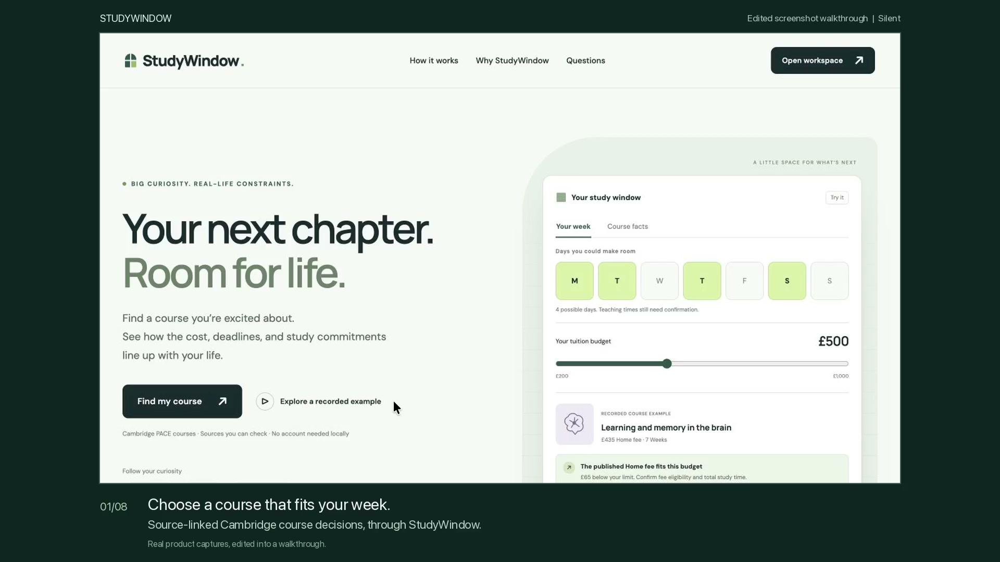
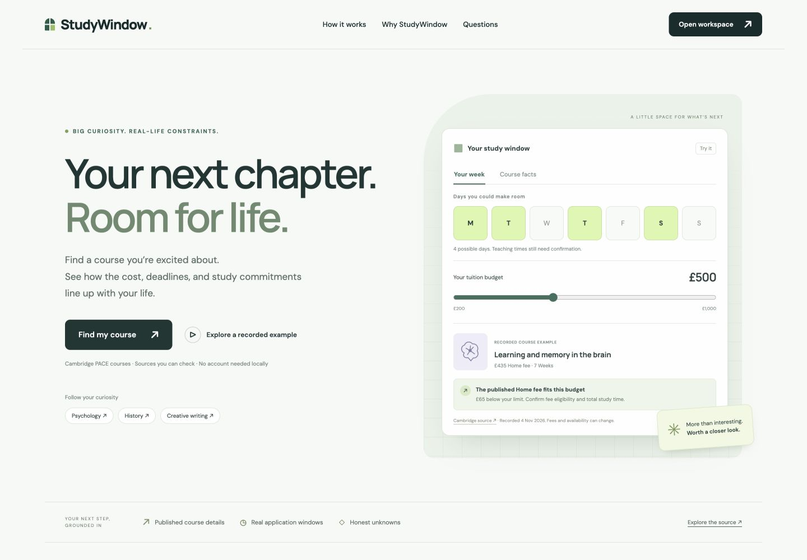

# StudyWindow

Find a continuing-education course that fits your interests, budget, application window, and available time. StudyWindow turns the public Cambridge Professional and Continuing Education catalogue into four typed MCP tools, then separates practical matches, conflicts, and unanswered questions.

A course being online does not establish that it fits a working learner’s week. A future start date does not establish that applications are open. StudyWindow keeps those distinctions visible, alongside source links and retrieval receipts.

> Fresh verification passed on 11 November: autonomous search, inspection and comparison through MCP, a healthy source canary and a valid empty-result search. The entry is unsubmitted; promotion and final portal checks remain. See the [preparation record](docs/NOV12-READINESS.md) and [actual conversation](evidence/conversations/candidate-2026-11-11/MCP-CONVERSATION.md).

[](media/studywindow-demo.mp4)

[72-second walkthrough](media/studywindow-demo.mp4), silent and captioned. It uses actual product captures and a clearly labelled export of the genuine 11 November MCP conversation. Saved examples keep their original timestamps.

This is an original local build for TinyFish Bounty Drop 002’s **Site to MCP** bounty. The implementation uses TinyFish **Agent**, **Fetch**, and **Browser** for substantive parts of the supported workflow: search interaction, fresh page evidence, and deterministic course-panel retrieval. Current verification, credit accounting, and claim/submission status belong in [the verification record](evidence/VERIFICATION.md); a build or a saved receipt alone is not proof that the complete live journey passed.

## Run locally

Requires Node.js 22 or later and npm. The recorded local preview needs no API key or account. Live tools additionally require an existing TinyFish API key and TinyFish beta access for the enforced Agent step cap. No public deployment or database is needed.

```sh
git clone https://github.com/himanshu748/studywindow.git
cd studywindow
npm ci
npm run build
npm test
npm run verify:mcp
npm run demo
```

Open [the landing page](http://127.0.0.1:4387), then use **Explore a recorded example** to inspect genuine saved receipts. Each section retains its original evidence time. With no live configuration, actions that would call TinyFish are disabled.

`verify:mcp` connects a real SDK client over stdio, advertises the four schemas, and exercises disabled-live failure paths. It makes no TinyFish calls. It is a protocol test, **not** a model-driven conversation. Offline CI is configured for Node.js 22 and 24. The 8 November hosted check was blocked by an account restriction. The recorded local checks are separate evidence; neither is a live-provider check.

Keep the existing API key in a private file outside this directory, readable only by your account. The parser accepts allowlisted, unquoted `KEY=value` lines; credentials remain server-side:

```dotenv
TINYFISH_API_KEY=your-existing-key
```

Do not put that real file in source control, a browser bundle, a screenshot, or an evidence package. Set its permissions to `0600`. Verify the account's current Fetch tier and quota before live use. The examples use an observed Hobby tier. `STUDYWINDOW_FETCH_TIER=hobby|builder` selects that exact wallet meter; it does not change the account tier. Omit it only for an account returning the older generic Fetch meter. The unchanged $0 Fetch ceiling blocks a paid Builder rate. Then explicitly enable live work in the server process:

```sh
export STUDYWINDOW_ENV_FILE=/absolute/path/to/private/credentials.env
export STUDYWINDOW_STATE_DIR=/absolute/path/to/private/studywindow/state
export STUDYWINDOW_LIVE=1
export STUDYWINDOW_FETCH_TIER=hobby
npm run demo
```

Open [the product landing page](http://127.0.0.1:4387), then [the course workspace](http://127.0.0.1:4387/app). The landing preview uses labelled recorded evidence and makes no paid calls. Workspace live actions go through an official MCP client and the stdio server. Search a topic, inspect a course, select two or three courses, and compare them against a tuition budget and optional time constraints. The UI also exposes a live health check and an explicit **Open saved evidence** action. Saved evidence never replaces a failed live response automatically.

`STUDYWINDOW_STATE_DIR` defaults to `~/.config/studywindow/state`. Use the same durable directory for every process associated with this build. It is independent of PageProof. Do not change or delete it to reset the allowance. The private env file can also contain `STUDYWINDOW_LIVE=1`; an existing process environment value takes precedence. `STUDYWINDOW_STATE_DIR` must be set in the process environment, not in that file.

To run only the MCP server:

```sh
npm start
```

This process waits for an MCP host on stdin. Stdout is reserved for protocol messages.

## Connect an MCP host

Replace every `/absolute/path` example with an actual absolute path. Use an absolute Node executable because desktop hosts may not inherit your shell’s `PATH`.

Claude Desktop configuration:

```json
{
  "mcpServers": {
    "studywindow": {
      "command": "/absolute/path/to/node",
      "args": ["/absolute/path/to/studywindow/dist/stdio.js"],
      "env": {
        "STUDYWINDOW_ENV_FILE": "/absolute/path/to/private/credentials.env",
        "STUDYWINDOW_STATE_DIR": "/absolute/path/to/private/studywindow/state",
        "STUDYWINDOW_LIVE": "1",
        "STUDYWINDOW_FETCH_TIER": "hobby"
      }
    }
  }
}
```

Codex MCP configuration:

```toml
[mcp_servers.studywindow]
command = "/absolute/path/to/node"
args = ["/absolute/path/to/studywindow/dist/stdio.js"]
tool_timeout_sec = 900

[mcp_servers.studywindow.env]
STUDYWINDOW_ENV_FILE = "/absolute/path/to/private/credentials.env"
STUDYWINDOW_STATE_DIR = "/absolute/path/to/private/studywindow/state"
STUDYWINDOW_LIVE = "1"
STUDYWINDOW_FETCH_TIER = "hobby"
```

An example learner prompt is: “Find psychology courses at Cambridge PACE. Inspect promising options, then compare two with a GBP 500 tuition budget and six available study hours each week. Explain expired deadlines, conflicts, and missing schedule information.” This is a suggested prompt, not a claimed conversation transcript.

## Tools and cost limits

| Tool              | Purpose                                                                     | Essential TinyFish work                                                                                                 |
| ----------------- | --------------------------------------------------------------------------- | ----------------------------------------------------------------------------------------------------------------------- |
| `search_courses`  | Operate the catalogue search and study-mode filter; return one bounded page | One Agent run, followed by a fresh Fetch of the resulting page                                                          |
| `inspect_course`  | Read offering dates, fees, deadline, requirements, and teaching evidence    | Fresh Fetch plus one bounded Browser session; strictly checked same-page HTML recovery for transient navigation failure |
| `compare_courses` | Retrieve two or three distinct courses and compare their practical fit      | Fresh retrieval of every course with explicit transport provenance; deterministic local comparison                      |
| `health_check`    | Detect missing filter, listing, or course-detail contracts                  | Fresh catalogue Fetch plus a live detail canary using Fetch and Browser                                                 |

See [typed contracts and examples](docs/TOOLS.md) and [architecture and trust boundaries](docs/ARCHITECTURE.md).

If Browser navigation ends in a recognized transient network error, the candidate can read the same course's already-retrieved fresh Fetch HTML only when all required panels and fields are present. It returns `retrieval.mode: fresh_fetch_fallback`, records the Browser failure and leaves dynamic availability unknown. It does not make another Fetch, substitute saved data, or recover from access, authentication, TLS, cancellation or structural failures. The health check reports this condition as `degraded`. This recovery has offline tests. The fresh 11 November batch succeeded through normal Browser expansion and did not exercise the recovery branch live.

After a local adapter failure, an explicit `resume_agent_run_id` can continue completed search work from the same private build within one hour. It verifies the original run against its retained receipt and accounting, starts no new Agent run, and still requires fresh Fetch HTML. The original Agent timestamp remains visible with a continuation warning. The normal search path never switches to this recovery mode automatically.

The build allowance is **at most $6.80 of existing credits**. The original $5 plus $0.50 and $0.30 extensions were consumed under the preserved $5.80 controls. On 11 November the owner approved another $1 for one finite validation batch: at most two new Agent runs, four Browser sessions and seven Fetch URLs. The cumulative caps are 19 Agent runs, 32 Browser sessions and 54 Fetch URLs; all counts share the original ledger. This is not permission to repeat a failed batch or spend an unused remainder later. All earlier reservations remain counted. After explicit approval to raise the per-run bound, new Agent requests enforce `max_steps: 20` and a 150-second provider duration cap. The durable ledger conservatively reserves **24 billed steps × $0.016 = $0.384 per new run**, allowing for observed accounting overhead. The **19-run ceiling is a secondary limit**; the aggregate $6.80 reservation check can stop work earlier. Earlier lower-cap reservations, including the pilot and failed attempts, retain their recorded amounts and are not reset or recalculated. Authentication failures, cancellations, timeouts, and failed runs retain their reservations. Unexpected accounting above 24 steps blocks further Agent calls. Runs are never retried blindly.

Course inspection uses isolated TinyFish Browser sessions at the observed $0.002-per-minute rate. Each session reserves **$0.01**, with at most **32 sessions**, a 120-second operation bound, and a 30-second provider inactivity timeout. Agent and Browser reservations share the same aggregate **$6.80 ceiling**. Connections are closed and session deletion is attempted in `finally`; reservations remain counted even after failure or cancellation. Earlier failed Agent and Browser experiments retain their original usage. The configured Browser uses the documented direct connection option (`proxy_config.enabled: false`); earlier proxy failures remain preserved as diagnostics rather than being hidden.

Fetch uses `ttl: 0` and is free under [TinyFish’s pricing observed for this build](https://www.tinyfish.ai/pricing); the application still caps it at **54 URLs**. Two provider operations may be active at once. These application limits are separate from TinyFish’s account quotas. They do not create or enable billing, auto-reload, or new credits. Reserved cost is a conservative ceiling; step-based estimates and observed wallet changes must be reported separately.

## Supported coverage and honest limits

- One catalogue: `https://www.pace.cam.ac.uk/course-search`, with exact supported `/courses/<slug>` and `/node/<id>` course paths. Arbitrary domains and private-network targets are not accepted as tool inputs. Unexpected final redirects fail.
- Plain course topics of 3–100 characters; zero-based pages 0–16; returned limits 1–15. Source pages hold up to 15 rows. Pagination and omitted-on-page counts are explicit.
- Exact study modes: online learning, in person teaching, face to face teaching, hybrid, and remote delivery. They do not imply compatible teaching hours.
- One to three date offerings per inspected course. Other layouts or larger offering sets fail explicitly rather than being silently truncated.
- GBP fees retain home, overseas, standard, or unknown category and course/year/unknown basis. There is no currency conversion, fee-status determination, funding assessment, admission decision, application, or enrolment.
- Missing or contradictory fees, dates, and schedules remain visible. A deadline today has an unknown cutoff time. Dates are assessed against Europe/London. Complete teaching schedules are not established by this adapter, so absence of a weekday is not evidence of availability.
- TinyFish Browser opens course panels and reads literal DOM fields. Deterministic fee/date parsing and comparison are corroborated against fresh Fetch identity, offering count, and date labels. Isolated Browser contexts block service workers and WebSockets, restrict navigation and requests, and permit only the site’s observed read-only course-status POST in addition to GET/HEAD. There is no fallback between Browser, Agent detail extraction, fixtures, or saved evidence. Receipts are not independent certification of every source fact.

As of November 3, 2026, inspection of official navigation, catalogue behaviour, and targeted API-documentation searches found **no documented public API supplying the required PACE course fields**. The site does contain an internal availability-status AJAX route, discovered in its public JavaScript; that route does not supply the required catalogue and course-detail fields. This is bounded evidence about the absence of a documented public course API, not a claim that the website has no HTTP APIs or owner confirmation that no public or undocumented API exists. The observed [robots file](evidence/robots-observed.txt) does not disallow `/course-search` or `/courses`; the distinct generic `/search` route is disallowed. The [course terms](https://www.pace.cam.ac.uk/policies-and-reports/general-terms-and-conditions) concern booking and provision. StudyWindow does not retrieve student course materials. Direct requests from this development environment returned 403; TinyFish access must succeed normally, and blocked access fails explicitly.

## Product interface



The dedicated landing page has an interactive budget and availability preview, a keyboard-accessible product tour, and FAQ disclosures. The workspace supports a shortlist within the current session, grid/list views, sorting of the loaded page, an inspection drawer, and offering tabs for compact comparisons. Subject links prefill a query without starting a paid run. Live action readiness reflects the retained allowance; recorded inspections and preference editing remain available when a live action cannot fit. Recorded examples retain original timestamps.

[Design research and motion decisions](docs/DESIGN.md) document the comparable course apps studied, original visual direction, and reduced-motion behavior. Fonts are bundled locally with their original OFL licenses in `demo/assets`.

## Evidence and handoff

The [11 November actual MCP conversation](evidence/conversations/candidate-2026-11-11/MCP-CONVERSATION.md) completed search, model-selected inspection and two-course comparison. A new [healthy source canary](evidence/readiness-2026-11-11/live-health.json) and [valid empty-result search](evidence/readiness-2026-11-11/live-empty-search.json) also passed. Earlier psychology/history/pagination receipts and the failed 5 November conversations remain preserved as historical evidence. The fresh batch used normal Browser expansion; it does not establish live Fetch recovery or permanent resolution of intermittent source access.

[Verification](evidence/VERIFICATION.md) distinguishes implementation, offline tests, genuine TinyFish live calls, actual MCP conversation evidence, public deployment, and claim/submission state. [Submission notes](docs/SUBMISSION.md) map the bounty requirements to evidence and outstanding gates. [Showcase drafts](docs/SHOWCASE-DRAFTS.md) are prepared text, not posted announcements.

The bounty was claimed through the authenticated platform during the build; it has **not** been submitted. Submissions are final. The technical live checks are complete. Required promotion, current form/link checks and the owner's final click remain submission gates. The reviewed source is published in [this GitHub repository](https://github.com/himanshu748/studywindow). Deployment and social posting remain separate actions.

No source-code license has been selected. The [MIT proposal](docs/PROPOSED-LICENSE.txt) is a draft for review, not an applied license. Cambridge content, TinyFish services, and their names and trademarks retain their respective rights.
