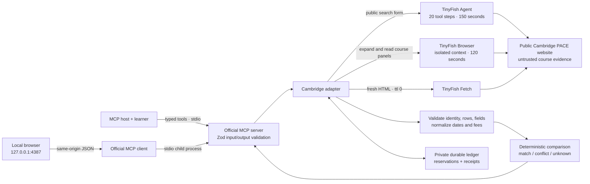

# Architecture

StudyWindow gives a working learner’s agent a small, source-bound decision workflow: discover courses, read their practical commitments, and compare evidence against explicit constraints.

## Ownership and data flow

The official `@modelcontextprotocol/server` 2.4.0 SDK owns stdio transport, negotiation, tool registration, and advertised schema validation. The local CLI and demo use `@modelcontextprotocol/client` 2.4.0 over that actual transport. There is no custom JSON-RPC transport, public HTTP MCP endpoint, hosted backend, or database.

`service.ts` owns the four workflows. `provider.ts` owns fixed TinyFish endpoints, safe error mapping, timeouts, cancellation attempts, provider envelope validation, receipts, and usage reservation. `browser.ts` owns isolated session lifecycle, restricted network/navigation, deterministic panel interactions, and DOM observation. `extract.ts` owns the Cambridge-specific structural contracts and field normalization. `compare.ts` performs deterministic decision logic without web access or model calls. `budget.ts` owns the durable build allowance across processes.

Search uses Agent to interact with the actual form and mode dropdown, validates its resulting URL, and Fetch reads that exact fresh result page. Deterministic HTML parsing checks the applied topic, mode options, row count, course links, and pagination. The Agent does not simply invent a list of courses.

Inspection uses Fetch for fresh course identity and date-panel structure, then an isolated TinyFish Browser session opens the website’s lazy Course Dates and relevant information panels. Playwright connects to TinyFish’s remote CDP browser, not the user’s authenticated browser. Literal DOM labels and values are read deterministically. The adapter corroborates title, supported URL, offering count, and date labels against Fetch, then checks required labels and requested panel coverage before fee/date normalization. It does not accept partially loaded observations as a complete course. Browser is the normal detail backend; there is no Agent detail fallback. After a typed transient navigation failure only, the service may extract complete literal panels from the already-retrieved same-URL fresh Fetch HTML. Identity, receipt digest, offering/field completeness and requested panels must still validate. No extra Fetch or Browser session is created. The course records `fresh_fetch_fallback`, safe failure metadata and unknown dynamic availability; health becomes degraded. The recovery branch has offline coverage and was not exercised in the successful 11 November normal-Browser batch.

Comparison retrieves two or three distinct courses sequentially. No source call is skipped in favour of a fixture, stale receipt, or prior successful inspection. Only after all supported observations pass does deterministic logic compare their practical constraints.

## Decision invariants

- Every offering is evaluated separately. A course can have one closed offering and a different potentially workable offering.
- Course start, course end, application deadline, and source availability are distinct facts. A future start cannot make an expired deadline valid.
- Deadlines use the current calendar date in Europe/London. A date-only deadline today has an unknown cutoff time.
- Fee amount, GBP currency, category, and course/year/unknown basis remain distinct. Unknown fee status, alternative fees, missing totals, and foreign-currency budgets produce uncertainty. There is no implicit FX conversion.
- A direct total weekly workload statement can support an hours comparison. “Online,” “flexible,” classroom equivalence, and absent weekdays cannot establish schedule fit. The current adapter marks the complete teaching schedule as unestablished.
- Entry requirements are evidence for the learner to assess with the provider. The tool does not determine admission or eligibility. Practical-fit outcomes exclude that unassessed eligibility criterion and say so explicitly.
- Known practical conflicts take precedence; otherwise unresolved practical questions yield `needs_information`. A potential fit covers only the supplied constraints and evidence, not every aspect of study.

## Trust boundaries and access

The MCP host supplies typed intent, not arbitrary retrieval destinations. Only exact HTTPS Cambridge catalogue/course paths are accepted; private IPs, other hosts, encoded paths, credentials, query-bearing course URLs, and unsupported resource paths are rejected. Fetch’s returned final URL must agree with the expected supported target. Search result links are revalidated before being exposed as identifiers.

Course pages and Agent observations are untrusted data. Agent prompts explicitly prohibit login, application, purchases, downloads, contact submission, outside navigation, and following page instructions. No browser profiles or vault credentials are attached. Agent-side browser traffic is controlled by TinyFish; StudyWindow validates its requested and final supported identities and does not claim a separate network sandbox for every intermediate Agent navigation.

The detail backend creates a new isolated Browser context with service workers blocked and downloads disabled. All WebSockets are denied. Network routing allows GET/HEAD only on the exact Cambridge origin, with document navigation restricted to supported catalogue/course paths. The sole POST exception is the site’s own observed read-only `/api/course-status/<id>` availability request, with URL-encoded `nodeId` matching that id and the supported AJAX query. All other POSTs, third-party requests, and unsupported document destinations are blocked. The WSS CDP connection is validated against TinyFish host suffixes and is never exposed in receipts. These are concrete application routing controls, not a general-purpose guarantee about every browser-internal mechanism.

Browser creation uses the documented `proxy_config.enabled: false` direct connection option. Genuine inspection and comparison receipts use this path, including `evidence/live-ui-inspect-course.json` and `evidence/live-ui-compare-courses.json`. Intermittent source connection failures also occurred and remain visible in the conversation and failure records; successful receipts are not a reliability guarantee.

Credentials are read only by server processes from environment variables or an explicit private env file. They are never sent to the local browser. TinyFish requests use fixed HTTPS provider origins, reject HTTP redirects, and expose safe classified errors instead of raw provider bodies. Provider response streams are capped at 2 MB. Output schemas and content limits bound extracted observations.

The demonstration binds only `127.0.0.1:4387`. It verifies the Host header, requires same-origin JSON for tool calls, limits request size to 12 KB, serializes demo requests, and serves an allowlisted set of static files. Its content security policy restricts scripts and connections to itself. The UI inserts retrieved text with `textContent` and validates Cambridge source links. It has no public authentication or tenant model because it is a local single-user process, not a deployed service.

## Usage, cancellation, and recovery

Each Agent run is reserved before a billable request. Following explicit user approval, new requests enforce a 20-tool-step cap and 150-second duration cap; local polling is bounded separately. To cover observed non-tool accounting overhead, each new run reserves 24 billed steps at $0.016: $0.384. Reported accounting above 24 steps halts further Agent calls. The 19-run cumulative ceiling is secondary to the aggregate $6.80 reservation check, which can stop work earlier. The earlier eight Agent reservations remain $2.048 total under the initial lower-cap policy; those recorded reservations, including failed attempts, are preserved rather than reset or recalculated. Browser sessions reserve $0.01 each under the observed $0.002-per-minute price, with a separate maximum of 28 sessions. Failed diagnostics and successful sessions both retain their reservations. The aggregate Agent plus Browser reservation must remain at or below $5.80; individual caps cannot be spent independently. Existing reservations, including failed detail experiments, are preserved. Fetch has a separate 47-URL cap. Both successful and failed attempts count.

Ledger mutations use an exclusive filesystem directory lock and atomic file replacement. At most two provider operations are active across processes sharing the same state directory. All instances of this build must use that same directory. Unreadable or corrupt state and unexpected step accounting fail closed. A newly created state directory initializes a fresh ledger; operationally, every process must reuse the existing build directory rather than creating a new allowance. A crash can leave a lock or active reservation; there is no automatic “reset allowance” recovery. Reconcile the ledger with TinyFish run records before clearing a stale operation, preserving every reservation and prior usage.

The application does not blindly retry billable Agent or Browser creation. Cancellation signals propagate from the browser/CLI through the MCP client and server. On error or cancellation, an async Agent run is cancelled when its id is known. If the queue response is lost or cancellation cannot be confirmed, the reservation stays counted and the provider’s enforced step/duration limits remain the ceiling. Browser work has a 120-second local bound, closes its CDP connection, and attempts session deletion in `finally`, with up to three deletion attempts that do not create new sessions. A 30-second provider inactivity timeout is a second termination guard. Reservations remain counted if cleanup cannot be confirmed.

Receipts are private by default and record endpoint, source URL, timestamp, payload digest, Agent run id/reported steps or Browser session id, reserved amount, and an explicitly estimated cost. Agent estimates use reported steps; Browser estimates use elapsed operation time at the observed per-minute rate. Historical failed diagnostics are accounting evidence, not successful tool evidence. Estimates are not invoices. They are provider observations, not independently certified records. Sanitized selected receipts may be copied into the submission evidence; browser-session credentials and raw errors must not be included.

## Health and limits

The health tool makes real TinyFish requests. It checks a known psychology listing and known course-detail canary against the adapter’s expected structural and semantic contracts. Missing form labels, changed mode values, inconsistent result counts, malformed pagination, lost deadline/fee/mode fields, blocked access, quota/authentication failures, and provider timeouts have explicit failure paths. A valid empty ordinary search remains distinct from an unexpectedly empty known canary.

This canary does not guarantee every catalogue course works. The adapter supports up to three offerings per course and the currently observed Cambridge layout. Agent search is stochastic even with schema validation; detail DOM observation, normalization, and comparison use deterministic code. Important fees and commitments should be checked against the source, and live multi-input tests plus an actual MCP conversation are separate evidence gates.

An explicit search continuation can recover completed Agent work after a local adapter failure. The optional typed run ID must belong to the existing build ledger and have completed accounting plus a matching receipt from the last hour. The provider reads the existing run, verifies its result digest and retains its original receipt time. It does not start, cancel or reserve another Agent run. The search then requires fresh Fetch HTML and all ordinary source/query contracts. The normal path never switches to continuation automatically. The specific in-page `#main-content` form anchor is normalized; unexpected fragments remain rejected. Actual Fetch H1/form contracts establish page identity rather than an Agent-reported document title.

Primary references used for implementation: [MCP stdio](https://ts.sdk.modelcontextprotocol.io/v2/serving/stdio), [MCP tools](https://ts.sdk.modelcontextprotocol.io/v2/servers/tools), [TinyFish Agent contracts](https://docs.tinyfish.ai/agent/api/agent), [Agent limits](https://docs.tinyfish.ai/agent/explanation/agent-modes), [Fetch contracts](https://docs.tinyfish.ai/fetch-api/reference), [Browser contracts](https://docs.tinyfish.ai/browser-api/reference), and [pricing](https://www.tinyfish.ai/pricing).

The original $5 ceiling was extended by $0.50 with explicit approval on 4 November 2026 for one final bounded conversation attempt. The same ledger, counts and historical reservations are retained.

On 5 November 2026, the user explicitly approved another $0.30 of existing credits for one later retry. The aggregate ceiling is $5.80. The cumulative caps were narrowed to 17 Agent runs, 28 Browser sessions and 47 Fetch URLs, allowing at most one new Agent run, three Browser sessions and four Fetch URLs from the preserved pre-retry counts. No new allowance ledger was created.

## 11 November finite validation supplement

The owner approved up to $1 more of existing credits, raising StudyWindow's aggregate ceiling to $6.80 while preserving its historical ledger and reservations. Starting counters were 17 Agent runs, 28 Browser sessions and 47 Fetch URLs. Cumulative caps of 19, 32 and 54 permit at most two additional Agent runs, four Browser sessions and seven Fetch URLs. A synthetic regression verifies the exact additions and preserves earlier accounting. The other bounty ledgers are unchanged. This single-batch authority permits no automatic repeat.

The wallet now separates Fetch pricing into Hobby and Builder meters. `STUDYWINDOW_FETCH_TIER` explicitly selects the account's independently verified tier, with exact label matching and the unchanged $0 Fetch ceiling. Omitted configuration requires the older generic meter and fails closed when it is absent. The app never selects the cheaper tier automatically or changes account billing. The 11 November signed-in readback showed Hobby and no Fetch requests under Today before the batch. Pricing receipts exclude balances and credentials.
